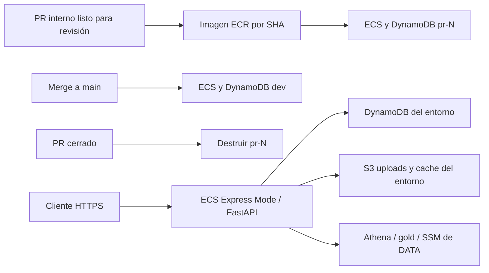

# Field Shift API

Backend de NASA Space Apps en Python 3.13 y FastAPI. Esta rama prepara la
migración a contenedores con ECS Express Mode, ECR y DynamoDB. La migración real
de `dev` se verifica después del merge mediante las tareas de `a5-migrate-dev`.
Terraform administra AWS y GitHub Actions usa OIDC, sin llaves guardadas en GitHub.

Bootstrap también prepara `AWSServiceRoleForECS`, un prerrequisito de cuenta
administrado por AWS. Se conserva al destruir previews; CI solo administra los
tres roles propios de cada entorno.



| Entorno | Activación | Estado Terraform | Recursos |
| --- | --- | --- | --- |
| `dev` | Merge a `main` o ejecución manual desde `main` | `environments/dev/terraform.tfstate` | Servicio, bucket versionado y tabla protegida contra borrado |
| `pr-N` | PR interno abierto y fuera de borrador | `environments/pr-N/terraform.tfstate` | Servicio, tabla y bucket descartables; cierre destruye el entorno |

Los forks y borradores ejecutan checks sin desplegar. Los applies de un mismo
entorno se serializan y no se cancelan. Todo cambio entra a `main` por PR.

## Desarrollo local

Requisitos: Python 3.13; Docker para la imagen; Terraform 1.14.x y AWS CLI
para infraestructura. Desde PowerShell:

```powershell
py -3.13 -m venv .venv
.\.venv\Scripts\python.exe -m pip install -r requirements-dev.txt
.\.venv\Scripts\python.exe -m uvicorn app.main:app --reload --port 8000
```

En Linux/macOS usa `python3.13` y `.venv/bin/python`. Para Docker:

```powershell
docker build -t fieldshift-api .
docker run --rm --name fieldshift-api -p 8080:8080 -e ENVIRONMENT=pr-7 fieldshift-api
```

Desde otra terminal: `curl.exe http://localhost:8080/health`,
`docker exec fieldshift-api id -u` y `docker stop fieldshift-api`.
La API corre como usuario 10001, escucha en 8080 y recibe SIGTERM directamente.
CI verifica salud, exclusión de archivos privados y apagado en menos de 10 s.

`GET /health` y `/docs` funcionan sin credenciales AWS. `/ready` y `/v1/sources`
todavía usan el lector de manifiestos existente; su sustitución por el proveedor
de datos pertenece a `c1` y `c2`. El esquema de `contracts/` se conserva porque
todavía documenta ese contrato. El nuevo rol no concede acceso a manifiestos.

## Bootstrap y migración

Antes de desplegar el PR, aplicar el bootstrap ampliado con credenciales de
administrador y su estado remoto existente. Revisar el plan: no debe destruir
el bucket de estado ni reemplazar el proveedor OIDC.

```powershell
aws sts get-caller-identity
terraform -chdir=infra/bootstrap init -backend-config=backend.hcl
terraform -chdir=infra/bootstrap plan -var-file=bootstrap.tfvars -out=bootstrap.tfplan
terraform -chdir=infra/bootstrap apply bootstrap.tfplan
terraform -chdir=infra/bootstrap output -raw ecr_repository_url
```

Para una cuenta nueva, copiar `bootstrap.example.tfvars` a `bootstrap.tfvars`,
ejecutar `init` sin backend, revisar y aplicar. Después generar `backend.hcl`
desde el output `backend_config`, copiar `backend.tf.example` a `backend.tf`
y ejecutar `init -migrate-state -backend-config=backend.hcl`. Nunca iniciar un
bootstrap existente sin recuperar antes su configuración de backend.
El estado tiene versionado, cifrado, TLS, bloqueo público y bloqueo nativo S3.
Los archivos de estado, planes, backend y tfvars privados se excluyen de Git.

Variables adicionales del bootstrap:

| Variable Terraform | Valor por defecto |
| --- | --- |
| `data_region` | `us-west-2` |
| `data_lake_bucket` | `null`: `fieldshift-lake-<cuenta>` |
| `athena_results_bucket` | `null`: `fieldshift-athena-results-<cuenta>` |
| `athena_workgroup` | `fieldshift` |
| `glue_database` | `fieldshift_gold` |
| `data_version_parameter_prefix` | `/fieldshift/` |

Se conservan temporalmente los permisos de la plataforma anterior para destruir
sus recursos. Después de migrar `dev` y comprobar que ningún preview los usa,
`a5-migrate-dev` requiere retirarlos y aplicar bootstrap de nuevo. No retirarlos
antes: el apply de transición necesita esos permisos.

## Variables de GitHub Actions

Configurar las variables de repositorio después del bootstrap:

| Variable | Valor |
| --- | --- |
| `AWS_REGION` | Región de la API; por defecto `us-east-1` |
| `TF_PROJECT` | Proyecto de bootstrap; por defecto `nasa-farm` |
| `TF_STATE_BUCKET` | Output `state_bucket` |
| `AWS_DEV_ROLE_ARN` | Output `dev_role_arn` |
| `AWS_PREVIEW_ROLE_ARN` | Output `preview_role_arn` |
| `RUNTIME_PERMISSIONS_BOUNDARY_ARN` | Output `runtime_permissions_boundary_arn` |
| `ECR_REPOSITORY_URL` | Output `ecr_repository_url` |
| `API_CORS_ORIGINS` | Array JSON de orígenes exactos del frontend |
| `INFRA_ENABLED` | `true` al terminar la configuración |
| `DATA_PROVIDER` | `fixture`; cambiar a `athena` cuando esté implementado y DATA publique gold |
| `DATA_REGION` | `us-west-2` |
| `DATA_LAKE_BUCKET` | Opcional; nombre derivado de la cuenta si se omite |
| `ATHENA_RESULTS_BUCKET` | Opcional; nombre derivado de la cuenta si se omite |
| `ATHENA_WORKGROUP` | `fieldshift` |
| `ATHENA_DATABASE` | `fieldshift_gold` |
| `DATA_VERSION_PARAMETER` | `/fieldshift/data_version` |
| `BEDROCK_MODEL_ID` | `anthropic.claude-3-haiku-20240307-v1:0` |
| `CHAT_ENABLED` | `false`; activar cuando esté implementado el chat |

El pipeline usa el SHA de cabecera del PR o el commit de `main` como etiqueta
inmutable; una reejecución reutiliza la imagen existente. Terraform recibe
`image_tag` y `ecr_repository_url`. El resumen muestra URL, entorno, proveedor e
imagen. La prueba de humo verifica `/health` con reintentos durante dos minutos.
No añadir `environment:` de GitHub a los jobs sin actualizar la confianza OIDC.

## Relación con DATA

El lake y Athena pertenecen a DATA, en la misma cuenta y en `us-west-2`.
El contrato de vistas, versiones y fuentes está en
[docs/fuentes_de_datos.md](docs/fuentes_de_datos.md).
La API recibe `DATA_PROVIDER`, `DATA_REGION`, `DATA_LAKE_BUCKET`,
`ATHENA_RESULTS_BUCKET`, `ATHENA_WORKGROUP`, `ATHENA_DATABASE` y
`DATA_VERSION_PARAMETER`. Terraform parametriza los mismos nombres en minúsculas.
Los permisos permiten leer `gold/`, consultar el workgroup, leer Glue y SSM, y
usar el bucket de resultados de Athena. No permiten escribir en el lake.
Cada entorno puede escribir únicamente su tabla y `uploads/` y `cache/` de su
bucket. El rol de tarea conserva el límite de permisos del bootstrap.

## Validación

```powershell
.\.venv\Scripts\python.exe -m ruff check .
.\.venv\Scripts\python.exe -m ruff format --check .
.\.venv\Scripts\python.exe -m pytest -q
terraform fmt -check -recursive infra
terraform -chdir=infra/bootstrap init -backend=false -lockfile=readonly
terraform -chdir=infra/bootstrap validate
terraform -chdir=infra/bootstrap test
terraform -chdir=infra/environment init -backend=false -lockfile=readonly
terraform -chdir=infra/environment validate
terraform -chdir=infra/environment test
actionlint
docker build -t fieldshift-api .
```

Las pruebas Terraform usan AWS simulado y no crean recursos.
Actualizar las dependencias y los locks de forma deliberada. El proveedor queda
fijado en `.terraform.lock.hcl`; conservar checksums Windows y Linux.

## Previews, recuperación y límites

Abrir los PR como borrador mientras se trabaja: un servicio encendido tiene
coste continuo y no escala a cero. No hay el límite de peticiones de API Gateway;
CORS restringe navegadores y no sustituye autenticación. La API sigue siendo
pública. El stack usa VPC y clúster por defecto, sin NAT ni VPC propia.
Los logs duran 30 días en dev y 3 en previews. El bucket de preview expira objetos
a los 7 días; esa regla no elimina infraestructura.

El cierre destruye servicio, tabla, bucket, roles y logs del preview. Si falla,
usar **Cleanup preview** desde `main` con el número de un PR cerrado. No borrar
el estado manualmente. Comprobar que no hay applies activos antes de liberar un
bloqueo concreto con `terraform force-unlock`.
Ver [docs/preview-lifecycle.md](docs/preview-lifecycle.md) para la transición y
la evidencia que debe capturarse en el PR.

## OpenSpec y estructura

OpenSpec 2.0.0 requiere Node.js >=22.12.0:
`npm install -g @fission-ai/openspec@2.0.0`. Consultar `openspec list` y validar
con `openspec validate --all --strict`. Los artefactos se redactan en español.

```text
app/                         FastAPI, configuración y lector de datos actual
contracts/                   Contrato de manifiesto todavía utilizado
infra/bootstrap/             Estado remoto, OIDC, ECR y permisos de CI
infra/environment/           ECS Express Mode, DynamoDB y bucket por entorno
infra/*/tests/               Pruebas Terraform sin credenciales
tests/                       Pruebas de la API
Dockerfile                   Imagen Python 3.13 con uvicorn
.github/workflows/           Checks, publicación, despliegue y limpieza
openspec/                    Especificaciones y tareas
```
