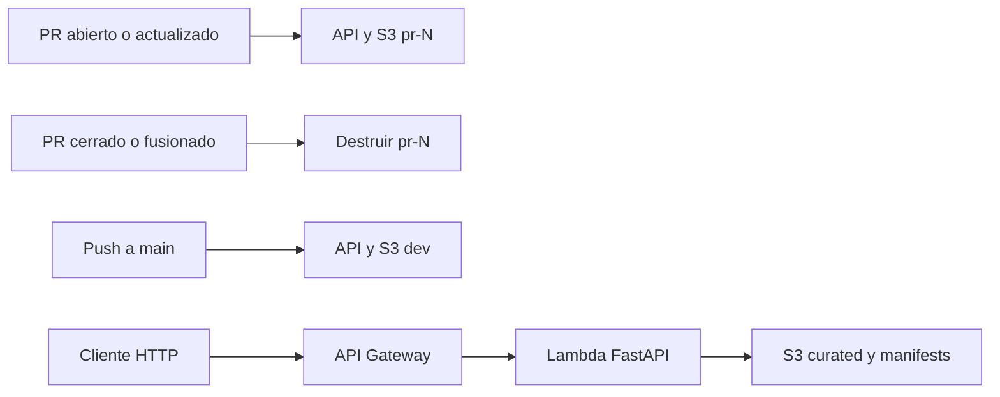

# Field Shift API

Backend de Field Shift para NASA Space Apps. API en Python 3.13 con FastAPI y Mangum sobre AWS Lambda, API Gateway HTTP y data lake privado en S3. Terraform administra los recursos; GitHub Actions despliega con OIDC, sin llaves AWS guardadas en GitHub.

Este setup incluye infraestructura y la base de la API. La descarga de datos NASA, el motor agronómico y sus endpoints se implementan después.



| Entorno | Activación | Estado Terraform | Datos |
| --- | --- | --- | --- |
| `dev` | Push a `main` o ejecución manual desde `main` | `environments/dev/terraform.tfstate` | Bucket propio, versionado, sin borrado forzado |
| `pr-123` | PR interno hacia `main`, abierto y fuera de borrador | `environments/pr-123/terraform.tfstate` | Bucket propio y descartable; sus objetos expiran en 7 días |

Los PR de forks ejecutan las comprobaciones sin obtener credenciales AWS. Los despliegues de un mismo entorno se serializan y no se cancelan a mitad de un apply. No se crean entornos de producción ni recursos del frontend.

Todo cambio a `main` debe entrar mediante PR. La regla activa [main-pr-only](https://github.com/magdiel-gvdz/nasa-farm-back/rules/27274344) exige PR, bloquea force pushes y borrados de `main`, y no incluye actores con bypass. El evento `push` a `main` del workflow recibe el commit resultante del merge; no autoriza pushes directos.

## Desarrollo local

Requisitos: Python 3.13, Terraform 1.14 o posterior dentro de la serie 1.x, AWS CLI y credenciales válidas para el arranque inicial. CI fija Terraform 1.14.0 y el proveedor queda fijado en los archivos `.terraform.lock.hcl`.

Desde PowerShell, en la raíz del repositorio:

```powershell
py -3.13 -m venv .venv
.\.venv\Scripts\python.exe -m pip install -r requirements-dev.txt
.\.venv\Scripts\python.exe -m uvicorn app.main:app --reload --port 8000
```

En Linux/macOS se usa `python3.13` y `.venv/bin/python`. Las dependencias runtime y de desarrollo están fijadas, incluidas sus dependencias transitivas.

| Endpoint | Comportamiento |
| --- | --- |
| `GET /health` | Liveness: proceso activo, versión de API y entorno; no consulta AWS |
| `GET /ready` | Consulta un manifiesto válido en S3; responde 503 si no hay datos publicados |
| `GET /v1/sources` | Fuentes declaradas en el manifiesto; responde 503 si no está disponible |
| `GET /docs` y `/openapi.json` | Documentación y contrato FastAPI |

Variables runtime: `ENVIRONMENT`, `DATA_LAKE_BUCKET`, `DATA_MANIFEST_KEY` (por defecto `manifests/manifest.json`) y `CORS_ORIGINS` (array JSON). Terraform las configura automáticamente en Lambda. Localmente, `/health` y `/docs` funcionan sin credenciales. Para leer S3 se usa la cadena normal de credenciales AWS; no se introduce ningún secreto en código.

## Arranque inicial de AWS

1. Selecciona una cuenta AWS para el proyecto y una región, por defecto `us-east-1`. Exporta `AWS_PROFILE` si usas un perfil local y confirma la cuenta con `aws sts get-caller-identity`.
2. Copia `infra/bootstrap/bootstrap.example.tfvars` a `infra/bootstrap/bootstrap.tfvars` y ajusta proyecto, región y repositorio. Si la cuenta ya tiene un proveedor OIDC de GitHub, configura `existing_github_oidc_provider_arn` para reutilizarlo.
3. Crea el bucket de estado y los roles. Este primer apply usa estado local:

```powershell
terraform -chdir=infra/bootstrap init
terraform -chdir=infra/bootstrap plan '-var-file=bootstrap.tfvars' '-out=bootstrap.tfplan'
terraform -chdir=infra/bootstrap apply bootstrap.tfplan
```

4. Migra inmediatamente el estado de bootstrap al bucket que acaba de crear:

```powershell
terraform -chdir=infra/bootstrap output -raw backend_config | Set-Content -Encoding ascii infra/bootstrap/backend.hcl
Copy-Item infra/bootstrap/backend.tf.example infra/bootstrap/backend.tf
terraform -chdir=infra/bootstrap init -migrate-state -backend-config=backend.hcl
```

Confirma la copia del estado que solicita Terraform. `backend.tf`, `backend.hcl`, los tfvars y los estados locales están ignorados por Git. No vuelvas a iniciar bootstrap sin su `backend.tf` una vez migrado. En otra máquina, recrea ambos archivos con los mismos valores y ejecuta `init -backend-config=backend.hcl` para recuperar el estado remoto.

El bucket de estado tiene versionado, cifrado, bloqueo de acceso público, política de TLS y `prevent_destroy`. Cada entorno usa una clave separada con bloqueo nativo S3 mediante `use_lockfile`; no requiere DynamoDB. Referencia: [backend S3 de Terraform](https://developer.hashicorp.com/terraform/language/backend/s3).

## Activación de GitHub Actions

Primero integra este setup en `main` con `INFRA_ENABLED` sin configurar. Después del bootstrap, configura estas **Repository variables** en Settings → Secrets and variables → Actions → Variables:

| Variable | Valor |
| --- | --- |
| `AWS_REGION` | La región usada en bootstrap, p. ej. `us-east-1` |
| `TF_PROJECT` | El mismo proyecto de bootstrap, por defecto `nasa-farm` |
| `TF_STATE_BUCKET` | Output `state_bucket` de bootstrap |
| `AWS_DEV_ROLE_ARN` | Output `dev_role_arn` |
| `AWS_PREVIEW_ROLE_ARN` | Output `preview_role_arn` |
| `RUNTIME_PERMISSIONS_BOUNDARY_ARN` | Output `runtime_permissions_boundary_arn` |
| `API_CORS_ORIGINS` | Array JSON de orígenes exactos del frontend, p. ej. `["http://localhost:5173"]` |
| `INFRA_ENABLED` | `true`, al terminar la configuración |

Ejecuta manualmente **API infrastructure** desde `main` para el primer despliegue de `dev`. Los siguientes pushes a `main` lo actualizarán. Un PR interno crea `pr-N` y el evento `closed`, tanto por cierre como por merge, elimina su Lambda, API, logs y bucket con sus datos. Las URLs y el nombre del bucket aparecen en el resumen de la ejecución de Actions.

No añadas `environment:` de GitHub a estos jobs sin actualizar la política OIDC: cambia el claim `sub`. Los roles validan repositorio, audiencia y contexto; el rol dev acepta solamente `main`, y el rol preview acepta PR internos y las tareas de recuperación desde `main`. Más información: [OIDC de GitHub con AWS](https://docs.github.com/en/actions/how-tos/secure-your-work/security-harden-deployments/oidc-in-aws).

## Data lake

Cada entorno usa un bucket privado distinto, con esta convención de objetos:

```text
raw/<source>/<dataset-version>/...             # Descargas originales
processed/<source>/<dataset-version>/...       # Series normalizadas
curated/<dataset-version>/cells/...            # Datos listos para la API
manifests/manifest.json                        # Versión activa y atribuciones
```

Los prefijos se crean al subir los objetos; no hay carpetas vacías artificiales. La Lambda solo puede hacer `GetObject` en `curated/` y `manifests/` de su propio bucket. No tiene permisos de escritura, borrado o lectura de `raw/`. El pipeline de ingestión no está incluido; debe usar una identidad diferente. No almacenes cuentas Earthdata ni datos personales de terrenos en el repositorio o el manifiesto.

El contrato de metadatos está en [contracts/data-manifest.schema.json](contracts/data-manifest.schema.json). Requiere una versión y al menos una fuente, con organización, enlace, resolución, periodo y licencia. Publica primero los datos curados y después el manifiesto, usando credenciales del responsable de datos:

```powershell
aws s3 cp data/curated/ s3://BUCKET-DEL-ENTORNO/curated/ --recursive
aws s3 cp data/manifest.json s3://BUCKET-DEL-ENTORNO/manifests/manifest.json --content-type application/json
```

Un despliegue nuevo **no incluye datos científicos de ejemplo**. `/ready` y `/v1/sources` devuelven 503 hasta publicar el manifiesto. La comprobación de despliegue usa `/health`, para que configurar infraestructura no dependa de haber completado el pipeline.

En `dev` el versionado conserva versiones anteriores hasta 90 días. No hay expiración de los objetos actuales. En previews los objetos expiran a los 7 días y el cierre del PR los elimina de inmediato. La regla S3 elimina objetos; no elimina la infraestructura si falla el workflow de cierre.

## Validación y paquete Lambda

```powershell
.\.venv\Scripts\python.exe -m ruff check .
.\.venv\Scripts\python.exe -m ruff format --check .
.\.venv\Scripts\python.exe -m pytest -q
terraform fmt -check -recursive infra
terraform -chdir=infra/bootstrap init -backend=false -lockfile=readonly
terraform -chdir=infra/bootstrap validate
terraform -chdir=infra/bootstrap test
terraform -chdir=infra/environment init -backend=false -lockfile=readonly
terraform -chdir=infra/environment validate
terraform -chdir=infra/environment test
.\.venv\Scripts\python.exe scripts/package_lambda.py
```

Las pruebas Terraform usan un proveedor simulado, sin credenciales ni recursos reales. El empaquetador descarga wheels Linux x86_64 para Python 3.13 incluso si se ejecuta desde Windows; el ZIP queda en `build/api.zip`. Actualiza los locks de Python deliberadamente y prueba tanto la API como el empaquetado. Para actualizar AWS, usa `terraform init -upgrade` en ambos stacks, ejecuta `terraform providers lock -platform=windows_amd64 -platform=linux_amd64` en cada uno y versiona sus locks. Los checksums de ambas plataformas permiten validar los mismos paquetes desde Windows y los runners Linux con `-lockfile=readonly`.

## Recuperación de previews y límites

Si falla el borrado de un PR, usa el workflow manual **Cleanup preview** desde `main`, con su número. Verifica que el PR esté cerrado; el workflow vuelve a comprobarlo y solo admite nombres `pr-N`. No borres ni alteres su archivo de estado manualmente. Si hay un bloqueo tras una interrupción, comprueba antes que no haya ningún apply activo; luego libera ese bloqueo concreto con `terraform force-unlock` usando el backend del PR.

Los cambios estructurales de Terraform en un PR también requieren comprobar que el código de limpieza de `main` puede destruirlos; la limpieza normal usa el commit base del PR. Conserva los nombres de proveedores al refactorizar. Un cierre fallido requiere recuperación: no hay un recolector programado en este setup.

La API inicial es pública y no guarda terrenos ni cuentas. CORS restringe navegadores; no sustituye autenticación. API Gateway limita peticiones por entorno (dev: 10/s, burst 20; preview: 2/s, burst 5). Los logs se retienen 30 días en dev y 3 en previews. Los permisos de CI de Lambda, S3, estado e IAM se limitan por nombres; el plano de administración de HTTP APIs permite gestionar las APIs de la región en esta cuenta. Usa una cuenta dedicada al proyecto y revisa cualquier PR antes de ejecutar código con su rol de despliegue. No hay VPC, NAT Gateway, base de datos, Glue ni Athena; este alcance es la API y su almacenamiento de datos. No se ha desplegado infraestructura con solo clonar el repositorio.

## Estructura

```text
app/                         FastAPI, configuración y lector del manifiesto
contracts/                   Esquema del manifiesto de datos
infra/bootstrap/             Estado remoto, OIDC y permisos de CI
infra/environment/           Stack reutilizado para dev y pr-N
infra/environment/tests/     Planes de prueba con proveedor simulado
scripts/package_lambda.py    Empaquetado Linux para Lambda
tests/                       Contratos básicos de la API y adaptador Lambda
.github/workflows/           Checks, deploy y destrucción de previews
```
