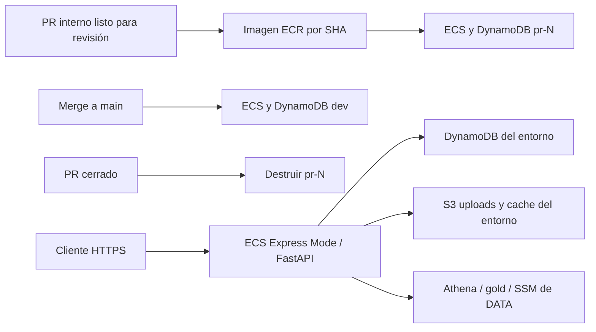

# Field Shift API

Backend de NASA Space Apps en Python 3.13 y FastAPI. Se ejecuta como contenedor
en ECS Express Mode, con la imagen en ECR y las geocercas en DynamoDB.
Terraform administra AWS y GitHub Actions usa OIDC, sin llaves guardadas en GitHub.

Bootstrap también prepara `AWSServiceRoleForECS`, un prerrequisito de cuenta
administrado por AWS. Se conserva al destruir previews; CI solo administra los
tres roles propios de cada entorno.



| Entorno | Activación | Estado Terraform | Recursos |
| --- | --- | --- | --- |
| `dev` | Merge a `main` o ejecución manual desde `main` | `environments/dev/terraform.tfstate` | Servicio, bucket versionado y tabla protegida contra borrado |
| `pr-N` | PR interno abierto y fuera de borrador | `environments/pr-N/terraform.tfstate` | Servicio, tabla y bucket descartables; cierre destruye el entorno |

Los forks y borradores ejecutan checks sin desplegar. Los applies de un mismo
entorno se serializan y no se cancelan. Todo cambio entra a `main` por PR.

## Desarrollo local

Requisitos: Python 3.13; Docker para la imagen; Terraform 1.14.x y AWS CLI
para infraestructura. Desde PowerShell:

```powershell
py -3.13 -m venv .venv
.\.venv\Scripts\python.exe -m pip install -r requirements-dev.txt
.\.venv\Scripts\python.exe -m uvicorn app.main:app --reload --port 8000
```

En Linux/macOS usa `python3.13` y `.venv/bin/python`. Para Docker:

```powershell
docker build -t fieldshift-api .
docker run --rm --name fieldshift-api -p 8080:8080 -e ENVIRONMENT=pr-7 fieldshift-api
```

Desde otra terminal: `curl.exe http://localhost:8080/health`,
`docker exec fieldshift-api id -u` y `docker stop fieldshift-api`.
La API corre como usuario 10001, escucha en 8080 y recibe SIGTERM directamente.
CI verifica salud, exclusión de archivos privados y apagado en menos de 10 s.

| Endpoint | Comportamiento |
| --- | --- |
| `GET /health` | Liveness: proceso activo, versión de API y entorno; no consulta AWS |
| `GET /ready` | Estado del proveedor de datos y versión cargada; responde 503 si aún no está listo |
| `/api/v1/...` | Endpoints de negocio: catálogos, geocercas, perfil, aptitud y rotaciones. Ver [docs/api-contract.md](docs/api-contract.md) |
| `GET /docs` y `/openapi.json` | Documentación y contrato FastAPI; el contrato versionado está en `contracts/openapi.json` |

Todos los endpoints de negocio calculan con datos: las geocercas se guardan en DynamoDB,
`/api/v1/sources` lee del proveedor de datos, `/api/v1/crops` del catálogo
`data/crops.yaml` (campos en [docs/crop-catalog.md](docs/crop-catalog.md)) y el perfil, la
aptitud y las rotaciones salen de los motores descritos en
[docs/engines.md](docs/engines.md), con los parámetros de `config/engine.yaml`. El catálogo
y la configuración se validan al arrancar. Tras cambiar una
ruta o un esquema ejecuta `python scripts/export_openapi.py` y versiona
`contracts/openapi.json`; CI falla si queda desactualizado.

Variables de la aplicación: `ENVIRONMENT`, `CORS_ORIGINS` (array JSON) y
`APP_TABLE` (tabla DynamoDB de geocercas; vacía = memoria, los datos se pierden
al reiniciar). Terraform las configura en el servicio junto con las de DATA.
Localmente todo funciona sin credenciales AWS mientras `APP_TABLE` esté vacía.

`DATA_PROVIDER` elige de dónde salen los datos agroclimáticos: `fixture` o
`athena` (ver más abajo). El valor por defecto, `fixture`, sirve datos sintéticos de dos celdas (Saltillo
`E9_r0463_c0846` y La Laguna `E9_r0461_c0822`, 2016-2025) con las columnas del
contrato de DATA; `/ready` informa entonces `data_version: "fixture"` y cada
fuente lleva `data_class: "synthetic"`. Un valor desconocido impide arrancar.
Los archivos de `app/data/fixtures/` se generan con semilla fija; tras cambiar
`app/data/synthetic.py` hay que regenerarlos y versionarlos:

```powershell
.\.venv\Scripts\python.exe scripts/build_fixtures.py
```

## Bootstrap y migración

Antes de desplegar el PR, aplicar el bootstrap ampliado con credenciales de
administrador y su estado remoto existente. Revisar el plan: no debe destruir
el bucket de estado ni reemplazar el proveedor OIDC.

```powershell
aws sts get-caller-identity
terraform -chdir=infra/bootstrap init -backend-config=backend.hcl
terraform -chdir=infra/bootstrap plan -var-file=bootstrap.tfvars -out=bootstrap.tfplan
terraform -chdir=infra/bootstrap apply bootstrap.tfplan
terraform -chdir=infra/bootstrap output -raw ecr_repository_url
```

Para una cuenta nueva, copiar `bootstrap.example.tfvars` a `bootstrap.tfvars`,
ejecutar `init` sin backend, revisar y aplicar. Después generar `backend.hcl`
desde el output `backend_config`, copiar `backend.tf.example` a `backend.tf`
y ejecutar `init -migrate-state -backend-config=backend.hcl`. Nunca iniciar un
bootstrap existente sin recuperar antes su configuración de backend.
El estado tiene versionado, cifrado, TLS, bloqueo público y bloqueo nativo S3.
Los archivos de estado, planes, backend y tfvars privados se excluyen de Git.

Variables adicionales del bootstrap:

| Variable Terraform | Valor por defecto |
| --- | --- |
| `data_region` | `us-west-2` |
| `data_lake_bucket` | `null`: `fieldshift-lake-<cuenta>` |
| `athena_results_bucket` | `null`: `fieldshift-athena-results-<cuenta>` |
| `athena_workgroup` | `fieldshift` |
| `glue_database` | `fieldshift_gold` |
| `data_version_parameter_prefix` | `/fieldshift/` |

Se conservan temporalmente los permisos de la plataforma anterior para destruir
sus recursos. Después de migrar `dev` y comprobar que ningún preview los usa,
`a5-migrate-dev` requiere retirarlos y aplicar bootstrap de nuevo. No retirarlos
antes: el apply de transición necesita esos permisos.

## Variables de GitHub Actions

Configurar las variables de repositorio después del bootstrap:

| Variable | Valor |
| --- | --- |
| `AWS_REGION` | Región de la API; por defecto `us-east-1` |
| `TF_PROJECT` | Proyecto de bootstrap; por defecto `nasa-farm` |
| `TF_STATE_BUCKET` | Output `state_bucket` |
| `AWS_DEV_ROLE_ARN` | Output `dev_role_arn` |
| `AWS_PREVIEW_ROLE_ARN` | Output `preview_role_arn` |
| `RUNTIME_PERMISSIONS_BOUNDARY_ARN` | Output `runtime_permissions_boundary_arn` |
| `ECR_REPOSITORY_URL` | Output `ecr_repository_url` |
| `API_CORS_ORIGINS` | `["*"]` permite cualquier origen; sin credenciales CORS |
| `INFRA_ENABLED` | `true` al terminar la configuración |
| `DATA_PROVIDER` | `fixture`; cambiar a `athena` cuando esté implementado y DATA publique gold |
| `DATA_REGION` | `us-west-2` |
| `DATA_LAKE_BUCKET` | Opcional; nombre derivado de la cuenta si se omite |
| `ATHENA_RESULTS_BUCKET` | Opcional; nombre derivado de la cuenta si se omite |
| `ATHENA_WORKGROUP` | `fieldshift` |
| `ATHENA_DATABASE` | `fieldshift_gold` |
| `DATA_VERSION_PARAMETER` | `/fieldshift/data_version` |
| `BEDROCK_MODEL_ID` | `anthropic.claude-3-haiku-20240307-v1:0` |
| `CHAT_ENABLED` | `false`; activar cuando esté implementado el chat |

El pipeline usa el SHA de cabecera del PR o el commit de `main` como etiqueta
inmutable; una reejecución reutiliza la imagen existente. Terraform recibe
`image_tag` y `ecr_repository_url`. El resumen muestra URL, entorno, proveedor e
imagen. La prueba de humo verifica `/health` con reintentos durante dos minutos.
No añadir `environment:` de GitHub a los jobs sin actualizar la confianza OIDC.

## Relación con DATA

El lake y Athena pertenecen a DATA, en la misma cuenta y en `us-west-2`.
El contrato de vistas, versiones y fuentes está en
[docs/fuentes_de_datos.md](docs/fuentes_de_datos.md).
La API recibe `DATA_PROVIDER`, `DATA_REGION`, `DATA_LAKE_BUCKET`,
`ATHENA_RESULTS_BUCKET`, `ATHENA_WORKGROUP`, `ATHENA_DATABASE` y
`DATA_VERSION_PARAMETER`. Terraform parametriza los mismos nombres en minúsculas.
Los permisos permiten leer `gold/`, consultar el workgroup, leer Glue y SSM, y
usar el bucket de resultados de Athena. No permiten escribir en el lake.
Cada entorno puede escribir únicamente su tabla y `uploads/` y `cache/` de su
bucket. El rol de tarea conserva el límite de permisos del bootstrap.

## Activar los datos reales (Athena)

Con `DATA_PROVIDER=athena` la API lee las vistas `v_*` de DATA (`docs/data_contract.md`). Al
arrancar carga en segundo plano las celdas y las fuentes: `/health` responde desde el primer
momento y `/ready` devuelve `503` hasta terminar. Los datos de cada celda se leen de Athena la
primera vez que se piden (unos segundos) y después se sirven desde memoria; las geocercas se
ubican en las celdas que publica DATA. Después comprueba el parámetro
SSM de versión cada `DATA_POLL_SECONDS` (300 por defecto) y recarga solo si cambió. Si una
recarga falla o lo publicado no supera la validación, sigue sirviendo la última versión buena.
Solo emite `SELECT` sobre vistas `v_*`, sin reutilización de resultados, y usa boto3
directamente (no `awswrangler`). La serie diaria (`v_cell_daily`) se pide por celda, bajo demanda.

Variables que necesita, además de `DATA_PROVIDER`: `DATA_REGION`, `ATHENA_WORKGROUP`,
`ATHENA_DATABASE` y `DATA_VERSION_PARAMETER`. Si falta alguna, la API no arranca y la nombra.
Terraform ya las configura en el servicio.

La serie diaria sale de la vista `v_cell_daily` de DATA. Si la vista no existe, la API la pide
a NASA POWER en vivo, una vez por cuadro climático, y guarda la respuesta en `cache/power/` del
bucket del entorno (`APP_BUCKET`; en local, un directorio temporal). Ajusta la temperatura por
altura con `LAPSE_RATE_C_PER_KM` (6.5 por defecto) y añade la fuente `power_live`. Un error de
permisos o transitorio en Athena no activa este respaldo.

**Antes de activar** deben cumplirse las condiciones de `c2-athena-provider`:

1. DATA publicó las seis vistas, incluida `v_sources`, y el parámetro SSM
   `/fieldshift/data_version` tiene una versión (no `none`).
2. DATA y backend acordaron un protocolo que impida leer vistas de dos publicaciones a la vez. La
   API descarta una carga si la versión cambió mientras cargaba, pero eso no es una garantía.
3. El rol de tarea puede leer SSM y consultar Athena en `DATA_REGION`.

**Activar:** cambiar la variable de repositorio `DATA_PROVIDER` a `athena`, relanzar el workflow
**API infrastructure** en `main` y comprobar que `/ready` informa la versión del parámetro SSM y
que `scripts/smoke_e2e.py --require-real` pasa en las dos zonas (ver `docs/smoke.md`).

**Volver atrás:** devolver `DATA_PROVIDER` a `fixture` y relanzar el workflow.

## Validación

```powershell
.\.venv\Scripts\python.exe -m ruff check .
.\.venv\Scripts\python.exe -m ruff format --check .
.\.venv\Scripts\python.exe -m pytest -q
.\.venv\Scripts\python.exe scripts/export_openapi.py --check
terraform fmt -check -recursive infra
terraform -chdir=infra/bootstrap init -backend=false -lockfile=readonly
terraform -chdir=infra/bootstrap validate
terraform -chdir=infra/bootstrap test
terraform -chdir=infra/environment init -backend=false -lockfile=readonly
terraform -chdir=infra/environment validate
terraform -chdir=infra/environment test
actionlint
docker build -t fieldshift-api .
```

Las pruebas Terraform usan AWS simulado y no crean recursos.
Actualizar las dependencias y los locks de forma deliberada. El proveedor queda
fijado en `.terraform.lock.hcl`; conservar checksums Windows y Linux.

## Previews, recuperación y límites

Abrir los PR como borrador mientras se trabaja: un servicio encendido tiene
coste continuo y no escala a cero. No hay el límite de peticiones de API Gateway;
CORS permite cualquier origen si se configura `["*"]`, sin credenciales. La API sigue siendo
pública y no guarda cuentas: las geocercas se separan por el encabezado
`X-Client-Id`, que no es autenticación. El stack usa VPC y clúster por defecto, sin NAT ni VPC propia.
Los logs duran 30 días en dev y 3 en previews. El bucket de preview expira objetos
a los 7 días; esa regla no elimina infraestructura.

El cierre destruye servicio, tabla, bucket, roles y logs del preview. Si falla,
usar **Cleanup preview** desde `main` con el número de un PR cerrado. No borrar
el estado manualmente. Comprobar que no hay applies activos antes de liberar un
bloqueo concreto con `terraform force-unlock`.
Ver [docs/preview-lifecycle.md](docs/preview-lifecycle.md) para la transición y
la evidencia que debe capturarse en el PR.

## OpenSpec y estructura

OpenSpec 2.0.0 requiere Node.js >=22.12.0:
`npm install -g @fission-ai/openspec@2.0.0`. Consultar `openspec list` y validar
con `openspec validate --all --strict`. Los artefactos se redactan en español.

```text
app/                         FastAPI y configuración
app/api/                     Rutas /api/v1, esquemas, errores y respuestas fijas
app/store/                   Repositorio de geocercas (memoria y DynamoDB)
app/geo/                     Malla de 9 km, validación de geometría y zonas
contracts/                   Contrato OpenAPI versionado
infra/bootstrap/             Estado remoto, OIDC, ECR y permisos de CI
infra/environment/           ECS Express Mode, DynamoDB y bucket por entorno
infra/*/tests/               Pruebas Terraform sin credenciales
app/profile/                 Perfil agroclimático de una celda
app/engines/                 Motores agronómicos (aptitud y rotaciones); docs/engines.md
config/engine.yaml           Umbrales y pesos de los motores
app/catalog/                 Modelo y carga del catálogo de cultivos
data/crops.yaml              Catálogo de cultivos; lo edita el rol científico
app/data/                    Proveedor de datos de DATA y datos sintéticos
scripts/export_openapi.py    Genera contracts/openapi.json
scripts/build_fixtures.py    Regenera los datos sintéticos de app/data/fixtures
scripts/smoke_e2e.py         Prueba de humo de extremo a extremo (docs/smoke.md)
tests/                       Pruebas de la API, la malla y el repositorio
Dockerfile                   Imagen Python 3.13 con uvicorn
.github/workflows/           Checks, publicación, despliegue y limpieza
openspec/                    Especificaciones y tareas
```
