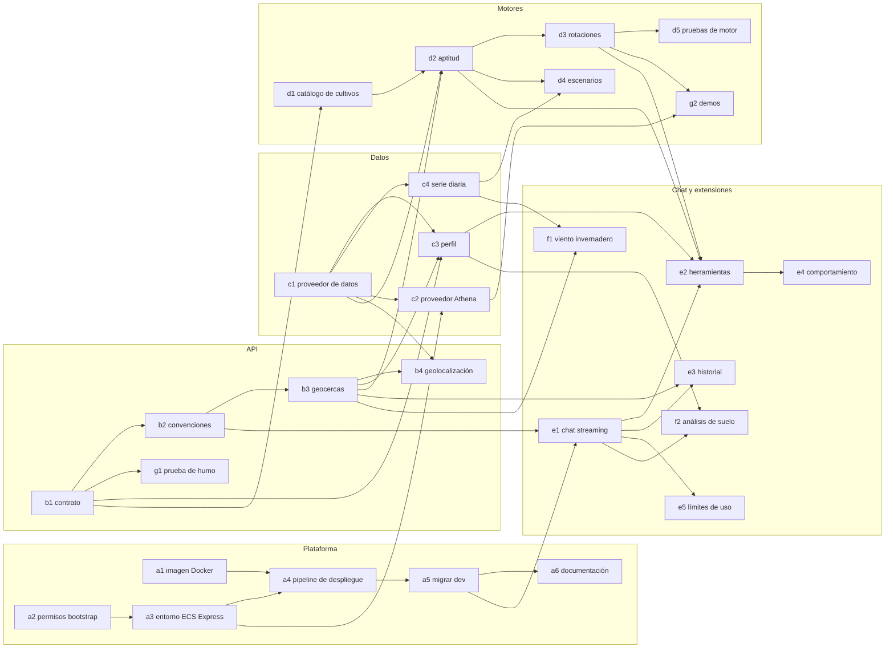

# Field Shift — Orden de las tareas del backend

> Complementa a [plan-backend.md](plan-backend.md). Cada identificador (`a1`, `b3`, …) es un spec en `openspec/changes/<id>-<nombre>/`.
> Aquí se responde: qué se hace primero, qué depende de qué y qué puede hacerse a la vez.

---

## 1. Lo esencial

- **Cinco tareas arrancan ya, a la vez y sin esperar a nadie:** `a1`, `a2`, `b1`, `c1` y `d1`.
- **Tres de ellas desbloquean casi todo lo demás:** `b1` (contrato), `c1` (proveedor de datos) y `a2` (permisos de AWS). Son la prioridad de las primeras dos horas.
- **A partir de ahí hay cuatro carriles independientes**, uno por persona. Dentro de un carril las tareas van en fila; entre carriles van en paralelo.
- **El camino más largo es el de motores:** `c1` → `d1` → `d2` → `d3` → `g2`, unas 12 horas seguidas. Cualquier retraso ahí retrasa el MVP.
- **El chat (`e1`-`e5`) no empieza hasta que `dev` corra en ECS (`a5`)** y necesita perfil y motores terminados para tener herramientas.

---

## 2. Mapa de dependencias

Una flecha `X --> Y` significa que `Y` no puede terminarse sin `X`.

---

## 3. Dependencias de cada tarea

"Para empezar" es lo mínimo que debe existir para escribir código. "Para terminar" es lo que debe estar fusionado para cerrar el PR; mientras tanto se trabaja con una pieza provisional que el propio spec describe.

### Plataforma

| Spec | Para empezar | Para terminar | Desbloquea |
|---|---|---|---|
| `a1` imagen Docker | Nada | — | `a4` |
| `a2` permisos bootstrap | Credenciales de administrador | Prueba manual de ECS Express Mode en la cuenta | `a3` |
| `a3` entorno ECS Express | `a2` aplicado | Va en el mismo PR que `a4` | `a4`, `c2` |
| `a4` pipeline de despliegue | `a1`, `a3` | — | `a5` |
| `a5` migrar dev | `a4` probado en un preview | Ningún preview abierto con Lambda | `a6`, `e1` |
| `a6` documentación | `a5` | — | — |

### API y estado

| Spec | Para empezar | Para terminar | Desbloquea |
|---|---|---|---|
| `b1` contrato | Acuerdo con frontend sobre las 5 diferencias | — | `b2`, `b3`, `b4`, `c3`, `d1`, `g1` y al frontend |
| `b2` convenciones | `b1` | — | `b3`, `e1` |
| `b3` geocercas | `b1` | `b2` (identidad del cliente); tabla real de `a3` para la prueba en preview | `b4`, `c3`, `d2`, `e3`, `f1` |
| `b4` geolocalización | `b1`; código de malla y CSV de celdas de DATA | `b3` (sustituye su localización provisional), `c1` (lista de celdas) | — |
| `g1` prueba de humo | `b1` | — | `g2` |

### Datos y perfil

| Spec | Para empezar | Para terminar | Desbloquea |
|---|---|---|---|
| `c1` proveedor de datos | Nada | `b1` y `b2` (conecta `/sources` y `/ready`) | `b4`, `c2`, `c3`, `c4`, `d2`, `d3` |
| `c3` perfil | `c1`, `b1` | `b3` (geocerca → celda), `b2` (idioma) | `e2`, `f2` |
| `c4` serie diaria | `c1` | `c2` solo para la vía de gold; el respaldo de NASA POWER no depende de nada más | `d4`, `f1` |
| `c2` proveedor Athena | `c1` | `a3` (permisos y variables) y **gold V0 publicado por DATA (H15)** | `g2` |

### Motores

| Spec | Para empezar | Para terminar | Desbloquea |
|---|---|---|---|
| `d1` catálogo de cultivos | Nada (5 cultivos de ejemplo) | `b1` (ruta `/crops`); catálogo de SCI | `d2`, `d3` |
| `d2` aptitud | `c1`, `d1` | `b3` (riego de la geocerca en el endpoint) | `d3`, `d4`, `d5`, `e2` |
| `d3` rotaciones | Firma de `d2` publicada (su primer commit), `d1`, `c1` | `d2` completo | `d5`, `e2`, `g2` |
| `d4` escenarios | `c4`, `d2` | `d3` (para aplicar el escenario a rotaciones); módulo de indicadores de DATA | — |
| `d5` pruebas de motor | `d2`, `d3` | `d4` es opcional (sus casos se omiten si no está) | `g2` |
| `g2` demos | `c2` con datos reales, `d3` | `d5` (instantáneas), `g1` | — |

### Chat y extensiones

| Spec | Para empezar | Para terminar | Desbloquea |
|---|---|---|---|
| `e1` chat streaming | `b2`; acceso al modelo en Bedrock | `a5` (verificación desplegada) | `e2`, `e3`, `e5`, `f2` |
| `e5` límites de uso | `e1` | `a3` (variables de entorno) | — |
| `e3` historial | `e1`, `b3` | — | — |
| `e2` herramientas | `e1`, `c3`, `d2`, `d3` | — | `e4` |
| `e4` comportamiento | `e2` | Revisión con SCI | — |
| `f1` viento invernadero | `c4`, `b3` | — | — |
| `f2` análisis de suelo | `e1`, `c3` | `d2` (usa el pH de laboratorio) | — |

---

## 4. Oleadas: qué puede hacerse a la vez

Todas las tareas de una misma oleada pueden estar en curso al mismo tiempo. Una oleada no espera a que la anterior termine entera: cada tarea empieza en cuanto se cumple su columna "para empezar".

| Oleada | Ventana | En paralelo | Condición para pasar |
|---|---|---|---|
| **0** | H6-H8 | `a1` · `a2` · `b1` · `c1` · `d1` | `b1` y `c1` fusionados: son las interfaces que usan todos |
| **1** | H8-H12 | `a3` + `a4` · `b2` → `b3` · `c3` · `c4` · `d2` · `g1` | `a2` aplicado; `d2` con su firma publicada |
| **2** | H12-H18 | `a5` → `a6` · `b4` · `c2` (desde H15) · `d3` · `d4` | `dev` en ECS; gold V0 publicado |
| **3** | H18-H24 | `d5` · `e1` → `e5` · `e3` · `g2` | **MVP en `dev`** |
| **4** | H24-H30 | `e2` → `e4` · `f1` · `f2` | Congelación en H30 |

### Por persona

Las celdas de una misma fila ocurren a la vez.

| Ventana | 1. Plataforma | 2. API y estado | 3. Datos y perfil | 4. Motores |
|---|---|---|---|---|
| H6-H8 | `a1`, `a2` | `b1` | `c1` | `d1` |
| H8-H12 | `a3` + `a4` | `b2`, `b3` | `c3` | `d2` |
| H12-H15 | `a5`, `a6` | `b4`, `g1` | `c4` | `d3` |
| H15-H18 | `e1` | `e3` (tras `e1`) | `c2` | `d3` |
| H18-H24 | `e5` | `e2` | `f1` | `d4`, `d5` |
| H24-H30 | `f2` | apoyo a `e2`/`e4` | publicaciones de DATA | `g2`, `e4` |

Si la persona 2 o la 3 quedan libres antes de H18, toman `d4` o `d5` para descargar a la persona 4.

---

## 5. Caminos críticos

Son las cadenas donde una hora de retraso es una hora de retraso del resultado.

| Camino | Cadena | Horas | Qué pone en riesgo |
|---|---|---|---|
| **Motores** | `c1` → `d1` → `d2` → `d3` → `g2` | 1.5 + 1 + 3 + 5 + 1.5 = **12** | El resultado central del reto (3 rotaciones explicadas) |
| **Chat** | `a2` → `a3` → `a4` → `a5` → `e1` → `e2` → `e4` | 2 + 3.5 + 1.5 + 0.5 + 2.5 + 2 + 1.5 = **13.5** | La extensión del chat; no afecta al MVP |
| **Datos reales** | gold V0 (H15) → `c2` → `g2` | 2.5 + 1.5 tras H15 | Que la demo use datos reales y no sintéticos |

Cómo acortarlos:

- **`d3` empieza con la firma de `d2`, no con `d2` terminado.** Es la primera tarea del spec de `d2` y ahorra unas 2 horas.
- **`d1` empieza con 5 cultivos de ejemplo**, sin esperar el catálogo de SCI.
- **`a2` es lo primero del carril 1**, porque necesita credenciales de administrador y todo el despliegue va detrás.
- **`c2` se escribe y prueba antes de H15** con un ejecutor de consultas simulado; al publicarse gold solo queda activarlo.

---

## 6. Bloqueos que no son código

| Bloqueo | A quién frena | Quién lo resuelve | Mientras tanto |
|---|---|---|---|
| Credenciales de administrador para aplicar el bootstrap | `a2` y todo el despliegue | Dueño de la cuenta AWS | El resto trabaja en local con datos sintéticos |
| Prueba de que la cuenta puede crear un servicio de ECS Express Mode | `a3` | Persona 1 | Si falla en 1 hora: Fargate + ALB clásico |
| Acuerdo con frontend sobre el contrato | `b1` | Persona 2 + FE | — |
| Código de malla y CSV de celdas de DATA | `b4` | DATA | `b4` usa una lista fija de celdas |
| Catálogo de cultivos y umbrales | `d1`, `g2` | SCI | 5 cultivos de ejemplo sin revisar |
| Módulo de indicadores de DATA | `d4` | DATA | Se implementan las definiciones del documento de DATA y la prueba de paridad decide |
| Vista `v_cell_daily` | `c4` | DATA | Respaldo con NASA POWER en vivo |
| Gold V0 publicado | `c2`, `g2` | DATA (H15) | `dev` sirve datos sintéticos |
| Acceso al modelo en Bedrock | `e1`, `e2`, `e4`, `f2` | Dueño de la cuenta AWS | Chat desactivado; el MVP no depende de él |

---

## 7. Tareas que tocan los mismos archivos

Pueden hacerse en paralelo, pero el segundo PR en fusionarse tendrá que actualizar su rama. Conviene avisar en el canal del equipo antes de fusionar.

| Archivo | Lo tocan | Cómo evitar el choque |
|---|---|---|
| `app/main.py` | `b1`, `b2`, `c1`, `a4` | Fusionar `b1` primero; los demás solo añaden líneas de registro |
| `contracts/openapi.json` | `b1`, `b3`, `b4`, `c3`, `d1`, `d3`, `d4`, `e1`, `e3`, `f1`, `f2` | Nunca resolver el conflicto a mano: actualizar la rama y volver a ejecutar `scripts/export_openapi.py` |
| `requirements.txt` y `pyproject.toml` | `a1`, `a4`, `b4`, `c2`, `e1` | Una dependencia por PR; regenerar el bloqueo tras actualizar la rama |
| `app/i18n.py` (catálogo de textos) | `b2`, `c3`, `d2`, `d3` | Claves con prefijo por módulo (`profile.`, `suitability.`, `rotation.`) |
| `config/engine.yaml` | `d2`, `d3`, `f1` | Una sección por motor |
| `docs/api-contract.md` y `docs/engines.md` | Casi todos | Una sección por endpoint o motor; añadir, no reordenar |
| `app/agent/stream.py` | `e1`, `e2`, `e3` | `e2` y `e3` no se hacen a la vez sobre este archivo: primero `e3`, después `e2` |
| `infra/environment/` | `a3`, `e5` | `e5` solo añade variables, después de `a5` |
| `.github/workflows/infrastructure.yml` | `a4`, `g1` | `g1` añade su paso después de fusionar `a4` |

---

## 8. Qué se recorta si falta tiempo

En este orden, de lo primero que se suelta a lo último:

1. `f2` análisis de suelo y `f1` viento de invernadero.
2. `e4`, `e2`, `e3`, `e5`, `e1`: el chat completo.
3. `d4` escenarios.
4. `b4` geolocalización real: las dos geocercas de demostración llevan su celda fija.
5. `c2` datos reales: la demo usa datos sintéticos y lo declara.

No se recortan: `a1`-`a5`, `b1`-`b3`, `c1`, `c3`, `d1`, `d2` y `d3`. Sin ellos no hay tres rotaciones explicadas que enseñar.
